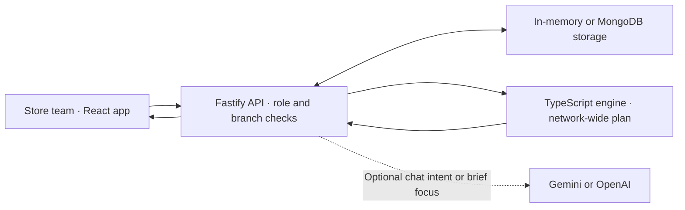

# StockFlow

StockFlow helps retail teams decide what to do with stock each morning. It uses sales and shelf counts to answer three questions: **Can another store spare this product? Should we reorder it? Would a markdown help clear the surplus?** It ranks those actions by estimated net benefit in Bahraini dinars (BD), including freight for transfers.

The demo covers **15 Bahrain branches, 500 products, and 120 days of synthetic history**. Daily reporting follows Bahrain time (UTC+3).

## Explore the architecture

For a walkthrough of the **morning plan**, **stock transfer**, or **AI assistant**, run the following from the repository root and open [the architecture explorer](http://127.0.0.1:4178/).

```sh
node demo/server.mjs
```

Choose a scenario, then step through its decisions. Each step shows the actor, input, outcome, and code location. The explorer plays illustrative scenarios locally and runs independently of the app, MongoDB, and AI providers. [Explorer source](demo/)

## Who uses it?

| Role | Where they start | What they can do |
| --- | --- | --- |
| **Company admin** | Network overview | See which stores reported today, review shortages and transfers across the network, and manage branches, products, and users. |
| **Branch manager** | Overview of assigned stores | Review recommendations, approve stock releases, request replenishment, and resolve issues flagged by staff. Open **Reports and trends** for stockout rates and financial estimates. |
| **Store staff** | Store inventory | Record units sold and closing stock, flag a shelf issue, track its resolution, and confirm deliveries. Staff see operational quantities for their assigned stores. |

### Follow one transfer

Suppose a store in Manama is running low on an item that another branch can spare. The manager opens **Daily work**, selects the shortage, and reviews the suggested transfer. The sending branch can approve the quantity it can release. Once committed, those units are reserved at the sending branch and appear as incoming at the receiving store. Staff open **Receive deliveries** when the stock arrives. The audit history records who acted, when, and why a quantity changed.

## Run the local demo

Use **Node.js 24.15 or later in the 24.x series** and **pnpm 12**. From the repository root:

1. Install the workspace dependencies.

   ```sh
   pnpm install --frozen-lockfile
   ```

2. Create a local `.env` file in the repository root. Enable sign-in and replace the placeholder with a private, randomly generated value. Leave `MONGODB_URI` empty for the in-memory demo.

   ```dotenv
   AUTH_ENABLED=true
   JWT_SECRET=<replace-with-a-random-secret-of-at-least-32-characters>
   MONGODB_URI=
   ```

3. Start the API and web app together.

   ```sh
   pnpm dev
   ```

4. Open the [local app](http://localhost:5173/). Expand **Demo accounts**, choose **Use** beside a role, then select **Sign in**. Try Manager to review an action, or Staff to record a stock count.

The in-memory demo supplies its own dataset and accounts. Restarting the API resets your changes. To check which storage mode is active, open [API health](http://localhost:3001/api/health).

### Add a day of sample sales

To review a fresh plan in the running app, set `ALLOW_SYNTHETIC_DATA=true` alongside `AUTH_ENABLED=true` in the API environment and restart the API. Sign in as an admin and choose **Products Catalog → Demo tools → Simulate today's sales**. The result shows the dataset date, participating branches, and number of new sales rows.

A fresh run advances the dataset by one day. For example, the original November 11 seed advances to November 12 even if the demo runs weeks later. The API allows one run per Bahrain calendar day. Sample rows feed the plan, while the reported-sales lookup counts store submissions. [Demo walkthrough](docs/DEMO.md)

## Morning briefs and transfer explanations

Select **Show my brief** on the daily dashboard or store inventory, or **Explain this transfer** in a transfer order. With sign-in enabled, StockFlow can produce a summary directly from the user's permitted records. Staff briefs cover shelf checks, receipts, and flags for their store.

Open the floating robot button to ask a question in your role. An admin can ask “How many products are over BD 200?” and follow up with “List them.” A manager can ask for the stock forecast at an assigned store. Staff can check incoming deliveries or ask how to flag a shelf issue.

The API chooses from supported read-only lookups and checks the signed-in employee’s branch access. When a provider helps interpret a question, it receives the question, previous lookup context if present, role, and authorized store names. For a brief, it can choose a highlight from scoped metric IDs and values. StockFlow builds the figures and destination links from its records.

For provider assistance, set `GEMINI_API_KEY` or `OPENAI_API_KEY` on the API and restart it. Gemini takes precedence when both are configured. Optional model settings are `GEMINI_MODEL` and `OPENAI_MODEL`. For local development, keep keys in the ignored root `.env`. Supported lookups and briefs also work with the built-in fallback.

## Use MongoDB for persistence

Set `MONGODB_URI` in the root `.env` to a MongoDB instance dedicated to this demo. The API uses the **`stockflow` database**. Use a replica set if you want order approvals and CSV batches to have multi-document transaction guarantees.

**Seeding replaces existing StockFlow demo data on that instance**, including sales entries, orders, and branches created in the UI. For a fresh demo database, stop the API, then run:

```sh
pnpm seed:mongo
pnpm dev
```

The seed creates the dataset, initial plan, and demo users. Subsequent starts only need `pnpm dev`. Check [database health](http://localhost:3001/api/health/db) to verify connectivity.

## How stock data becomes a decision



| Stage | What happens |
| --- | --- |
| **Record** | Staff enter sales and closing stock. Managers and admins can also preview a CSV, inspect row errors, and see which entries it will insert or update. A reported zero sale and a missing report carry different meanings in the forecast. |
| **Plan** | The engine estimates demand and compares stock across the entire network before filtering results to each user's branches. This lets a manager see a transfer involving an assigned store even when the other branch is outside their area. |
| **Approve** | A suggestion leaves inventory available. Committing a transfer reserves the sending store's units. The order keeps the original recommendation alongside the approved quantity and its event history. |
| **Refresh** | Physical updates such as a new shelf count refresh the stock plan. An order decision updates reservations and the queue independently. MongoDB stores sales history, entries, orders, and audit events and caches the latest plan versions. |

Estimated gains and simulated comparisons are planning figures. Realized savings depend on actual sales, fulfilment, and delivery costs. See the [forecasting assumptions and worked example](docs/ENGINE.md).

## Development

| Workspace | Responsibility |
| --- | --- |
| [`apps/web`](apps/web) | React, Vite, and Tailwind CSS. Role-specific screens for daily work, store inventory, and reporting. |
| [`apps/api`](apps/api) | Node.js and Fastify. Authentication, branch permissions, import validation, order transitions, and memory or MongoDB storage through repository interfaces. |
| [`packages/core`](packages/core) | Pure TypeScript forecasting, transfer matching, order rules, shared Zod schemas, and deterministic demo data. |
| [`demo`](demo) | Standalone architecture explorer with three interactive walkthroughs. |

| Command | Purpose |
| --- | --- |
| `pnpm test` | Run core, API, and web tests, including isolated MongoDB tests. |
| `pnpm lint` | Check code style and UI conventions. |
| `pnpm typecheck` | Check TypeScript across the workspace. |
| `pnpm build` | Run workspace builds and produce the web production bundle. |
| `pnpm bench:cold` | Measure initial plan loading and subsequent reads. |

For hosting, the repository includes a [Vercel configuration](vercel.json) that routes `/api/*` to Fastify and other requests to the web app. The demo sign-in panel can be hidden with the web build variable `VITE_SHOW_DEMO_ACCOUNTS=false`. Demo accounts remain valid until their credentials or account status change.

## Further reading

- [Demo walkthrough](docs/DEMO.md) — a guided tour of the seeded scenario.
- [API reference](docs/API.md) — endpoints and role permissions.
- [Architecture decisions](docs/ADR.md) and [known limitations](docs/DECISIONS.md) — design choices and trade-offs.
- [Frontend guide](docs/FRONTEND.md) — routes, shared components, and UI conventions.
- [Testing guide](docs/TESTING.md) — workspace checks and targeted regression suites.
